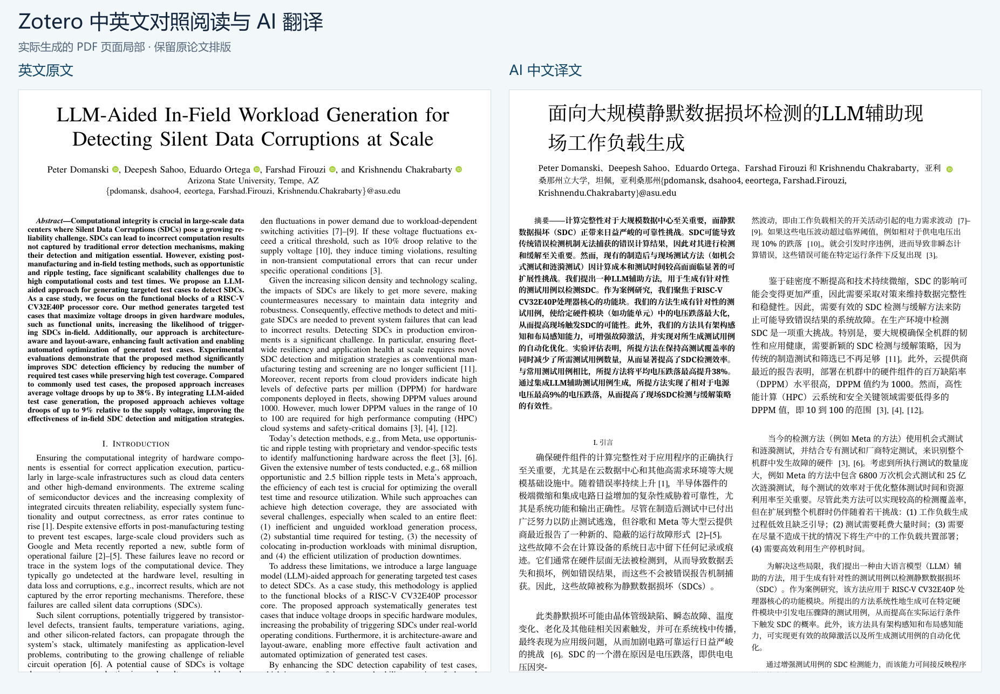

# Zotero 中英文对照阅读与 AI 翻译

在 Zotero 中把英文论文翻译成中文，左边看原文、右边看译文。尽量保留图表、公式和 PDF 版式，译文自动保存在原论文条目下。

[下载安装包](https://github.com/l00100/zotero-ai-bilingual/releases) · [安装说明](docs/INSTALL.md) · [来源与致谢](NOTICE.md)



_上图为实际生成的 PDF 页面局部，按原文与译文左右对照展示（由 PDF 直接渲染）。点击图片可查看大图。_

**这是一个衍生改进项目。** 本项目基于 [leisongju/zotero-hjfy-split-reader-cn v0.1.4](https://github.com/leisongju/zotero-hjfy-split-reader-cn/tree/v0.1.4)，该项目又基于 [Infinity4B/zotero-hjfy-split-reader](https://github.com/Infinity4B/zotero-hjfy-split-reader)。分屏阅读器和 HJFY 功能主要继承自上游；我们在此基础上增加通用 AI PDF 翻译、本地排版服务与相关使用改进。完整来源和各项目的贡献见 [NOTICE.md](NOTICE.md)，上游说明保存在 [docs/UPSTREAM-README-v0.1.4.md](docs/UPSTREAM-README-v0.1.4.md)。

[](LICENSE)

## 可以做什么

- 接入 OpenAI 兼容的 Chat Completions 接口，配置 Base URL、模型名和 API Key。
- 使用本地 PDF2zh-next / BabelDOC 排版服务处理已有 PDF，无需 arXiv ID。
- 尽量保留图表、公式、版式，生成译文附件并调用上游分屏阅读器。
- 相同文件及相同翻译设置复用已有译文；支持页码试译、进度、取消和已提交任务恢复。
- 默认尝试跳过参考文献：可靠识别后在临时副本中屏蔽参考文献区域，生成译文后恢复原始区域。同页正文和后续附录继续翻译。
- 关闭调试模式及版面调试框，增加初始化下载进度提示。
- 提供 macOS、Windows 本地服务安装脚本，使用独立 Python 环境。

上游已有的 HJFY 译文获取、arXiv 识别、批量获取、分屏滚动同步等功能继续保留。HJFY 的说明见 [上游原始文档](docs/UPSTREAM-README-v0.1.4.md)。

## 安装

从本仓库 [Releases](https://github.com/l00100/zotero-ai-bilingual/releases) 下载对应安装包，完整解压。包中包括 XPI、服务源码、安装脚本和许可证。

1. 在 Zotero 中打开 **工具 → 插件 → 齿轮 → 从文件安装插件**，选择 XPI。
2. 完全退出 Zotero。
3. 安装 Python 3.10–3.13（推荐 3.12），运行 `install/` 下对应平台的服务安装脚本。
4. 重新打开 Zotero，在本插件设置的 **AI 论文翻译** 区域填写接口地址、模型名和 API Key，点击“保存密钥”。
5. 点击“检查 / 启动本地翻译引擎”，先用 `1-2` 页试译，确认后再清空页码范围翻译全文。

macOS 可运行 `install/安装Mac服务.command`，或在终端执行 `bash` 加脚本路径。Windows 可在 PowerShell 中运行 `install/安装Windows服务.ps1`；也可使用 Python 直接运行 `install/windows_setup.py`。详细目录、恢复和启动方式见 [安装文档](docs/INSTALL.md)。

本分支沿用上游插件 ID，因此会替换同 ID 的上游插件，不能与其同时启用。显示名称已简化；现有内部 ID、配置键和服务目录继续沿用，以便保留已保存的设置和译文缓存。安装脚本只为这个改进版关闭自动更新，以免原版更新覆盖改动。请保留现有 Zotero 配置备份。

### 使用与保存

选中论文主条目或其原文 PDF，右键 **AI 翻译 PDF 并分屏打开…**。译文作为同一论文条目的新 PDF 附件保存；独立 PDF 没有父条目时，译文也单独保存。

在同一原文和相同设置下，再点该菜单会优先复用已有译文，不提交模型任务。更换模型、语言、页码、参考文献策略，编辑原文、删除译文或跨版本缓存格式变化时，可能需要重新生成。

## 本地服务与 AI 的区别

本地服务负责版面分析、PDF 处理和重排；**翻译文字仍然调用你配置的 AI 接口**，不是开箱即用的离线翻译。首次使用需要联网安装依赖，并可能下载数百 MB 的模型和字体。服务只监听 `127.0.0.1:8891`，不创建开机启动项。

API Key 使用 Zotero 凭据存储；本地服务不把模型密钥写入任务 JSON。论文文本会发送给你选择的模型服务商，可能产生费用。HJFY 模式还会访问其上游说明中的 HJFY、arXiv、OpenAlex 服务。请勿将自己的密钥、Cookie、论文、任务缓存或 Zotero 文库提交到本仓库。

## 兼容性与限制

- 此分支的实际 Zotero 使用验证来自 **Windows / Zotero 10.0.8**。清单允许至 Zotero 10，其他版本需要进一步验证。
- macOS 安装脚本经过配置逻辑、语法和原生引擎包可用性检查，**尚未完成真实 Mac 的 Zotero 分屏与全文翻译测试**。不应将其理解为已全面兼容所有 macOS 版本。
- 排版质量取决于 PDF、引擎和模型，复杂表格、扫描件、图片内文字、跨栏结构可能有误。
- 参考文献识别依赖常见标题和文本结构；无法可靠识别时会提示并按页码继续处理，必要时请手动限制页码。
- 当前 AI 菜单一次处理一篇论文，后台串行执行任务。取消操作无法撤回已经送到服务商的请求。
- 这是早期改进版，欢迎报告能复现的问题；提交样本前请确认你有权公开该文件。

## 开发与验证

```sh
npm ci
npm run build
npm run test:unit

python -m venv .venv
# 激活上面创建的环境后：
python -m pip install -r service/requirements.txt
python -m unittest discover -s tests -v
```

XPI 位于 `.scaffold/build/`。打包服务与平台脚本可执行 `npm run package:release`，结果写入 `dist/`。测试使用合成 PDF 和本机模拟 API，不需要真实密钥，也不应自动调用付费服务。

## 来源、历史与许可证

原插件的代码、提交历史、作者信息和许可证保留。AI 改进代码与公开发布整理由 [l00100](https://github.com/l00100) 维护；这不改变上游作者对原有功能的贡献。

- 上游基线：`leisongju/zotero-hjfy-split-reader-cn` **v0.1.4**，提交 `be96c218b1a220010c215b6b3c6a8354302b2d25`。
- 本地改进历史与公开版本说明：[CHANGELOG.md](CHANGELOG.md)。
- 包括分屏阅读器、模板、HJFY 接口及排版引擎在内的完整来源：[NOTICE.md](NOTICE.md)。

本仓库继续采用 **AGPL-3.0-or-later**，详见 [LICENSE](LICENSE)。第三方依赖各自的版权与许可证仍由其权利人保留；请同时遵守对应项目的许可。
